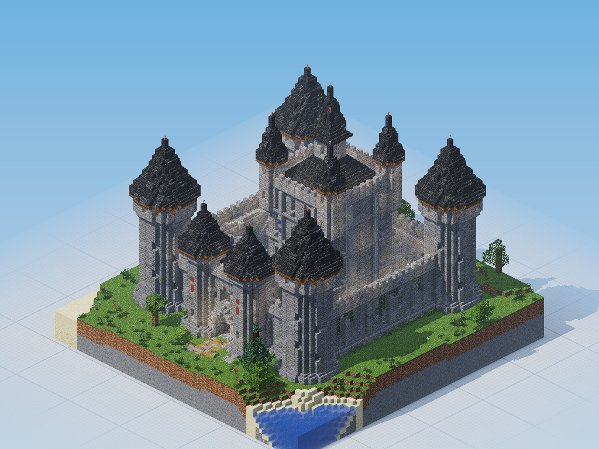
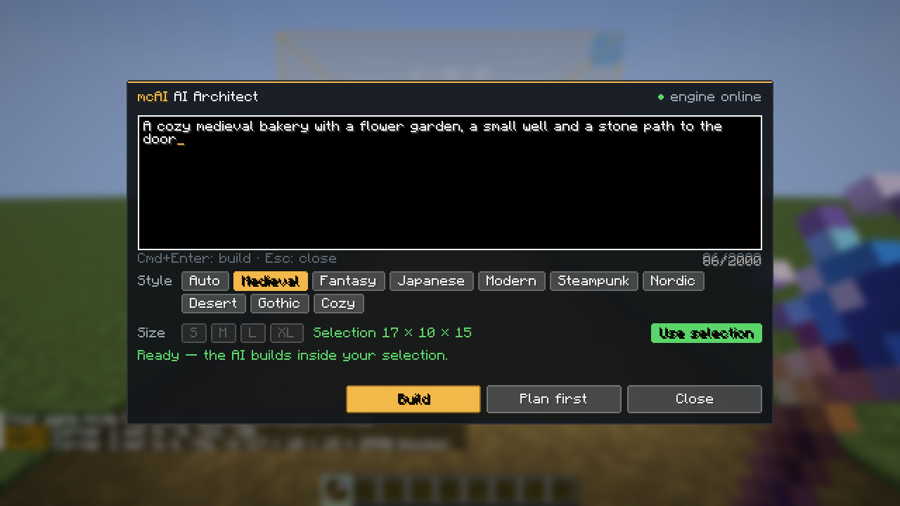
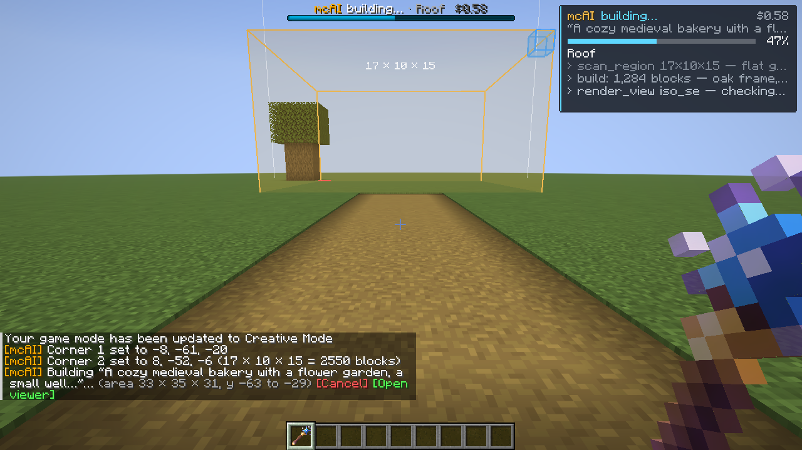
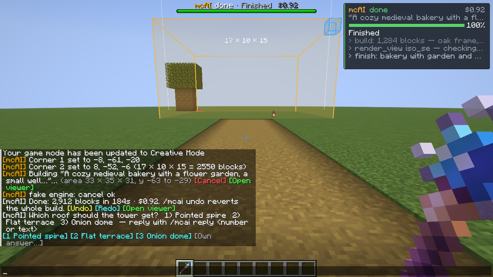
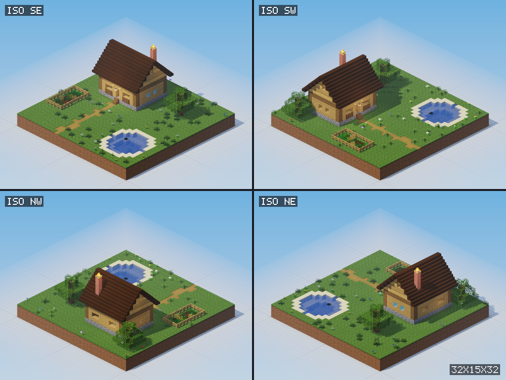
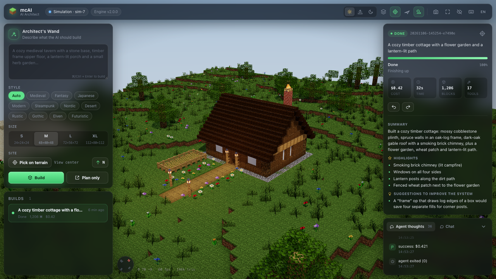
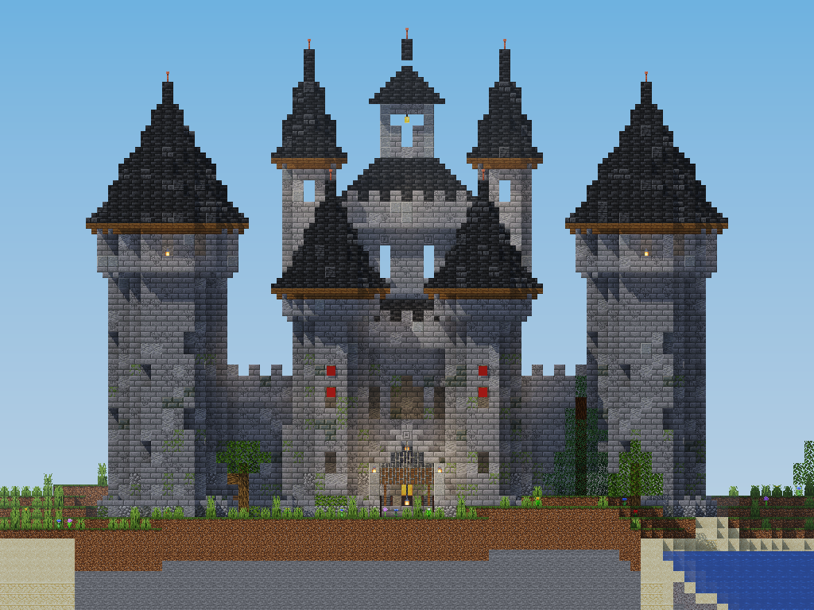
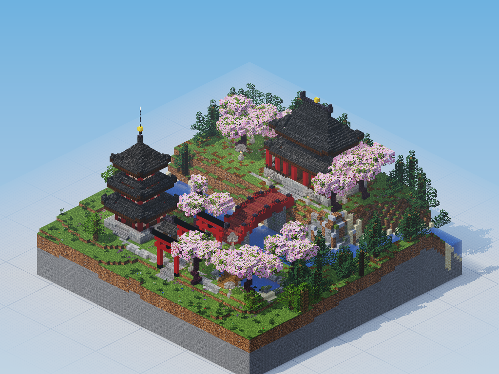
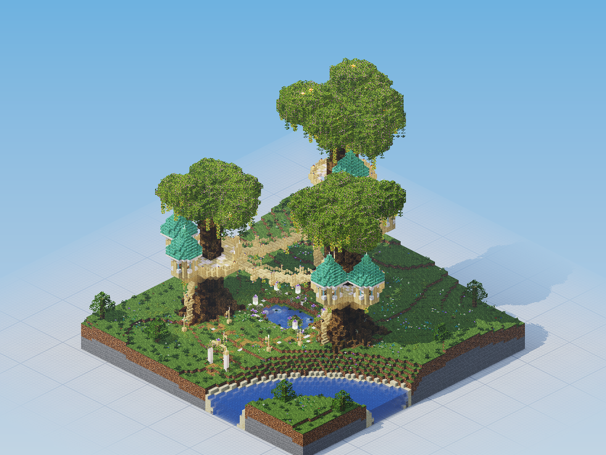
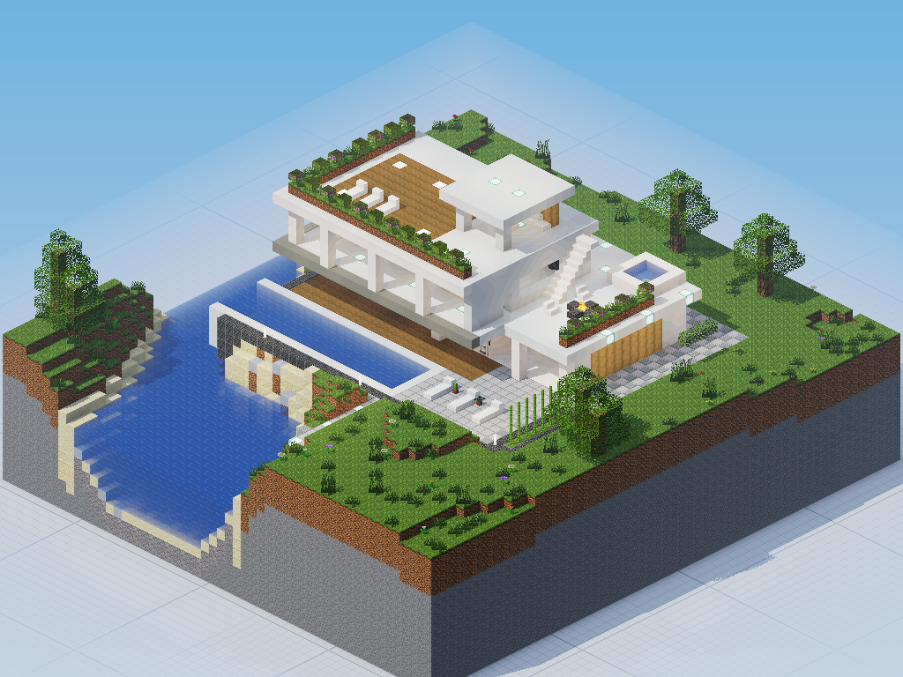

# mcAI — an AI architect for Minecraft

<p align="center">
  
</p>

<p align="center"><em>One prompt, nine minutes, 44,627 blocks. This castle was designed, built, inspected and fixed by mcAI on its own.</em></p>

Select a spot in your world with the **Architect's Wand**, describe what you want ("a cozy medieval bakery
with a flower garden"), and a team of Claude agents designs and builds it. It's not a schematic lookup:
the agents read the terrain, plan, write procedural generators, place hundreds of thousands of blocks,
**render their own work to check it**, and fix what looks wrong. Everything the AI does can be undone
in one step.

mcAI targets **Minecraft Java 26.3 with Fabric**. It runs in singleplayer and on dedicated multiplayer
servers.

> Status: working and tested end to end (real singleplayer, real dedicated server, simulation), but
> young. Expect rough edges, and read [Safety](#safety) and [Cost](#cost) before you hand it to friends.

---

## Highlights

- **Build from inside the game.** A wand for WorldEdit-style selections, a prompt window (`B`) with
  style and size presets, a live HUD with progress, cost and the agent's current thoughts (`H`), a
  boss bar, and clickable chat buttons: `[Undo] [Redo] [Cancel] [Open viewer]`. When the AI asks a
  question, the answers are buttons too. English and German UI.
- **A Claude Code builder team.** A "master architect" plans the build and delegates to subagents
  (builder, landscaper, interior designer, detailer, critic). They all share one toolbox and one undo
  history.
- **Vision.** A software ray tracer renders the build from any angle, at any time of day, cut away
  from the surrounding terrain. The agent looks at its build and corrects it before it reports done.
- **26 MCP tools**: perception (`get_context`, `scan_region` with floating-block and dark-spot checks,
  `render_view`, `heightmap`, `find_blocks`), building (`build` with a batched shape DSL: walls,
  roofs (gable, hip, cone, swept), arches, bridges, cylinders), `terraform`, prefabs, clipboard,
  structure library, `ask_player`, `progress`, `finish`, and an allowlisted `command` tool.
- **Procedural JS sandbox.** `run_script` executes agent-written generators (L-system trees, spiral
  stairs, organic terrain) in a locked-down Node child process. Good generators can be saved and
  reused in later builds.
- **WorldEdit-style tools without AI**: `/mcai copy | cut | paste | rotate | flip | set | replace |
  stack | save | load`, with block patterns and masks, and a structure library stored as Sponge
  `.schem` files (`~/.mcai/structures`) that both players and agents can reuse.
- **Simulation + live 3D web viewer.** A built-in voxel world with real terrain generation lets you
  run whole AI builds without Minecraft. The three.js viewer shows the simulated or the real
  world live as blocks are placed.
- **Multiplayer-ready.** One running job per player, permission levels, rate limits, server-side
  validation of every client packet, boss bars that follow players across rejoins, and vanilla
  clients still work through commands and chat.
- **Fast and safe placement.** Millions of blocks are time-sliced across ticks on the server thread
  (2,000,000 blocks in one request at a steady 20 TPS on a laptop). Chunks load asynchronously, fences
  and stairs connect correctly, block entities (chests, signs) are copied exactly, and undo is exact.

| Prompt window | Live HUD while building | Questions and actions in chat |
|---|---|---|
|  |  |  |

| What the agent sees (`render_view`) | Web viewer (simulation world) |
|---|---|
|  |  |

## Gallery

All of these are unedited single-prompt builds. Cost is the Claude API cost reported by Claude Code.
The first four were built headless in the simulation (`./mcai build "<prompt>"`). The last one is a
build from real singleplayer.

| | Prompt | Result |
|---|---|---|
|  | *"Build an imposing medieval castle on this site: keep, curtain wall with wall-walk, four corner towers with pointed roofs, gatehouse with portcullis, a small courtyard with a well. Breathtakingly detailed."* (German original) | 44,627 blocks · 9 min · **$1.96** · 42 tool calls |
|  | *"Build a serene Japanese temple complex: a three-tiered pagoda, a main hall with curved roofs, a torii gate path, cherry blossom trees, a koi pond with a wooden bridge and stone lanterns."* | 28,573 blocks · 11 min · **$2.86** · 58 tool calls |
|  | *"Create a magical elven treehouse village: three huge organic trees with houses in their crowns, connected by curved rope bridges, spiral stairs around the trunks, lanterns and a glowing pond below."* (German original) | 30,797 blocks · 11 min · **$2.76** · 29 tool calls |
|  | *"Build a modern luxury villa on the coast: cantilevered white concrete volumes, floor-to-ceiling glass, an infinity pool, a rooftop terrace with plants, and a minimalist interior."* | 6,927 blocks · 5 min · **$1.43** · 22 tool calls |
| *(real game, no render)* | *"baue was richtig krasses hier hin mit umgebung details und alles so"* (roughly: "build something really epic here, with surroundings, details and everything") | A hilltop castle with a curtain wall that follows the terrain, six round towers, a keep on the cliff, a gatehouse with portcullis, a courtyard with palace, smithy, stables and barracks, plus a market, pasture and lantern-lit paths. 38,571 blocks · 14 min · **$7.12** · 120 tool calls |

Per-run data (stages, tool calls, the agents' own suggestions) is in
[`docs/showcase/run*-summary.json`](docs/showcase).

## Quick start

```sh
git clone <this repo> mcai && cd mcai
./mcai setup      # engine deps, mod build, Fabric profile in the official launcher, health check
./mcai play       # starts the engine and opens the launcher; pick "mcAI · Fabric 26.3" → Play
```

In game: `/mcai wand` (or the creative inventory) → left-click and right-click two corners → press
**B** (or right-click into the air) → describe the build → **Build**. Without a selection, pick a size
preset (S/M/L/XL) and the AI builds where you look.

More commands:

```sh
./mcai start --sim                 # simulation world + web viewer, no Minecraft needed
./mcai build "a lighthouse on a rocky island"   # headless build in the simulation, PNG renders
./mcai server start --accept-eula  # dedicated Fabric server with mcAI (you accept the Minecraft EULA)
./mcai status | logs | jobs | feedback | doctor | update | uninstall
```

The full setup guide (launcher integration, server, performance settings, troubleshooting) is in
[docs/SETUP.md](docs/SETUP.md). It is written in German, with an English summary at the end.

## Requirements

| | |
|---|---|
| Minecraft Java Edition **26.3** | official launcher, started and logged in once. `./mcai setup` installs Fabric Loader 0.20.1 + Fabric API |
| **Node.js ≥ 22.18** | runs the engine (TypeScript runs natively, no build step) |
| **Claude Code CLI** | `npm install -g @anthropic-ai/claude-code`, then `claude` → `/login` with an Anthropic API key or a Claude subscription |
| **Java 25** | only for building the mod and running a dedicated server (the launcher brings its own Java for the game) |
| OS | developed on macOS. The Linux paths are implemented but less tested. Windows is untested. |

## How it works

```
 Minecraft 26.3 + Fabric                          mcAI engine (Node, 127.0.0.1:7878)
 ┌───────────────────────────────┐   WebSocket    ┌──────────────────────────────────────────┐
 │ mcai mod                      │◀──────────────▶│ mod bridge ─ WorldBackend (real | sim)   │
 │  wand, prompt GUI, HUD, chat  │   JSON, token  │ edit sessions · undo · region guard      │
 │  time-sliced block placement  │                │ block registry · shapes · scripts        │
 │  async chunk loading          │                │ ray-traced renderer · terrain simulator  │
 └───────────────────────────────┘                │ web viewer (three.js) · REST API         │
                                                  │ MCP server (/mcp, 26 tools)              │
                                                  └──────────────▲───────────────────────────┘
                                                                 │ MCP over HTTP, one job = one
                                                                 │ `claude -p` process
                                                  ┌──────────────┴───────────────────────────┐
                                                  │ Claude Code: master architect + builder, │
                                                  │ landscaper, interior designer, detailer, │
                                                  │ critic (agent/SYSTEM.md, agent/knowledge)│
                                                  └──────────────────────────────────────────┘
```

- The **mod** is a thin, fast executor. It reads and writes blocks on the server thread within a
  per-tick time budget, draws selections, and shows progress. All building logic lives in the
  engine.
- The **engine** owns one `WorldBackend` interface with two implementations, the real game (via the
  mod) and an in-memory simulation. Every edit goes through an edit session with undo, block limits
  and the job's allowed region.
- Each build is one headless **Claude Code** session (`claude -p`) whose only world access is the
  mcAI MCP server. Built-in tools are limited to read-only file access plus subagents.

Details: [docs/ARCHITECTURE.md](docs/ARCHITECTURE.md) (contracts and protocol),
[docs/ENGINE-API.md](docs/ENGINE-API.md) (engine modules), [docs/DEVELOPMENT.md](docs/DEVELOPMENT.md)
(repo layout, tests, toolchain).

## Safety

mcAI lets an AI change your world, and on a server it accepts requests from other players. Here is
what protects you:

- **Undo.** Every AI job is one undo step per player (`/mcai undo`, the `[Undo]` button, or a bindable key).
  Block entities are restored exactly.
- **Region guard.** A job may only edit its allowed box: your selection plus a margin (default 8
  blocks), or the size preset. Per-job and per-call block limits apply (default 2,000,000 / 500,000).
- **Command allowlist, checked twice.** The engine and the mod both check commands. Allowed:
  decorative `summon` (no hostile or explosive entities, also not as passengers), `fillbiome`,
  `particle`, `playsound`. There is no `op`, `execute`, `give`, `kill`, `tp`, `gamerule`, and no
  `@a`/`@e` selectors. The mod also refuses to create command blocks, structure blocks or signs with
  `run_command` click events (unless `allowCommandBlocks` is set). Copies of blocks that already
  exist, for example for undo, are still allowed.
- **Script sandbox.** Agent scripts run in a separate Node process under the Node permission model:
  no file writes, no network, no child processes. They also have a hard timeout, a heap cap and a
  block cap.
- **Local-only engine.** The engine binds to `127.0.0.1` and requires a token for the mod and MCP
  connections. It also has a DNS-rebinding guard and a same-origin check for the viewer.
- **Multiplayer permissions.** Starting builds needs permission level 2 by default (`config/mcai.json`
  → `buildPermissionLevel`; the singleplayer owner may always build). There is a per-player cooldown,
  one running job per player, and a global concurrency limit. Every client packet is validated
  server-side.
- **⚠️ LAN proxy.** `scripts/lan-proxy.mjs` exposes the engine's viewer and API on your network, for
  example to watch a build from a tablet. It rewrites `Host`/`Origin`, so **anyone who can reach it
  can start builds (which cost you money), undo and read the session token.** Only run it on networks
  you fully trust, and stop it afterwards.

## Cost

Builds use Claude Opus through Claude Code, billed to your Anthropic account or subscription. These
are real numbers from the gallery:

| Build | Typical cost | Time |
|---|---|---|
| Small (cottage, little house, bridge: a few hundred to ~1,500 blocks) | $0.40 to $1.40 | 30 s to 9 min |
| Medium (tower with surroundings, villa: ~7,000 blocks) | $1.40 to $1.90 | 5 to 7 min |
| Large showcase (castle, temple, village: 30,000+ blocks) | $2 to $3 | 9 to 12 min |
| "Go wild" with surroundings (120 tool calls) | about $7 | 14 min |

Every job has a budget cap (`budgetUsd`, default $10, in `~/.mcai/config.json`) and a timeout (45 min).
The HUD and boss bar show the running cost live. `./mcai jobs` lists past jobs with their cost.

## Development

```sh
cd engine && npm ci && npm test && npm run check           # engine unit/integration tests, type check
cd mod && ./gradlew build                                 # mod (Java 25, Fabric Loom)
tools/testserver.sh start && node tools/mod-protocol-test.mjs   # mod ↔ engine protocol against a real server
tools/client-gametest.sh [--dedicated]                    # real client: GUI, HUD, chat buttons, permissions
```

See [docs/DEVELOPMENT.md](docs/DEVELOPMENT.md) for the repo layout, the toolchain quirks (building on
networks that block Mojang's servers) and the builder agent's feedback loop (`./mcai feedback`).

## License & credits

mcAI is [MIT licensed](LICENSE). Copyright (c) 2026 mcAI contributors. It is not an official Minecraft
product and is not approved by or associated with Mojang or Microsoft.

Built on the shoulders of:

- [Fabric](https://fabricmc.net) (Loader, API, Loom) and the Fabric modding community
- [misode/mcmeta](https://github.com/misode/mcmeta) for the block registry and assets data behind the
  simulation and renderer
- [Claude Code](https://docs.anthropic.com/en/docs/claude-code) and the
  [Model Context Protocol](https://modelcontextprotocol.io)
- [three.js](https://threejs.org), [ws](https://github.com/websockets/ws),
  [pngjs](https://github.com/pngjs/pngjs), [prismarine-nbt](https://github.com/PrismarineJS/prismarine-nbt),
  [zod](https://zod.dev)
- The [Modrinth](https://modrinth.com) mods that `./mcai setup` installs for a smooth game:
  Fabric API, Sodium, Lithium, FerriteCore, ImmediatelyFast, Entity Culling and Dynamic FPS (plus Iris
  and MakeUp – Ultra Fast with `--shaders`). Each is the work of its own authors and under its own license.
